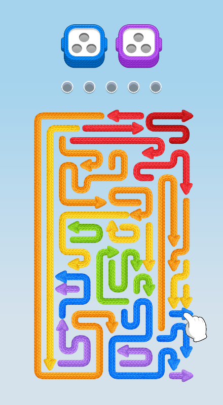
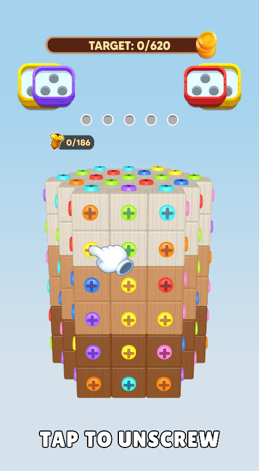
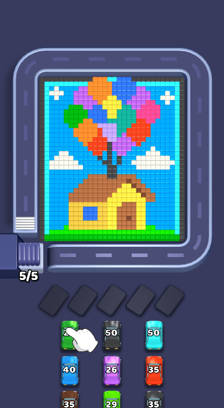

<table>
  <tr>
    <td width="270" align="center" valign="top">
      
    </td>
    <td valign="top">
      <h1>Hi 👋, I'm Duy (Duytv)</h1>
      <h3>Senior Game Developer · Cocos Creator &amp; Unity</h3>
      
I build games and playable ads for mobile and web. 6+ years of experience in gameplay systems, custom rendering and production automation.

    </td>
  </tr>
</table>

  <a href="https://duytv081298.github.io/Duytv081298/">Portfolio</a> ·
  <a href="https://www.linkedin.com/in/duytv98/">LinkedIn</a> ·
  <a href="mailto:duytv0812@gmail.com">Email</a> ·
  <a href="public/cv/TRINH-VAN-DUY_EN.pdf">English CV</a> ·
  <a href="public/cv/TRINH-VAN-DUY_VN.pdf">Vietnamese CV</a>

---

<table>
  <tr>
    <td width="50%" valign="top">
      <h2>👤 About Me</h2>
      
🎯 <strong>Current Focus:</strong> Building high-performance, engaging and scalable games and playable ads across Mobile, Web, and Instant Platforms.

      
🛠️ <strong>My work:</strong> All 30 playable demos in my portfolio were independently developed by me as the sole programmer.

      
🌐 <strong>Based in:</strong> Hanoi, Vietnam

      
💬 <strong>Languages:</strong> Vietnamese (Native), English (Intermediate)

    </td>
    <td width="50%" valign="top">
      <h2>🎮 Skills</h2>
      <picture>
        <source media="(prefers-color-scheme: dark)" srcset="skills-card-dark.svg" />
        <source media="(prefers-color-scheme: light)" srcset="skills-card.svg" />
        
      </picture>
    </td>
  </tr>
</table>

---

## 🧱 Tech Stack

  
  
  
  
  
  

---

## 🖥️ Selected Projects

Three examples of my work in rendering, 3D interaction and data-driven gameplay. I handled 100% of the programming for each project.

<table>
  <tr>
    <td width="33%" align="center" valign="top">
      
      <h3>Arrow</h3>
      
Custom ribbon meshes Continuous UV mapping

      <a href="https://duytv081298.github.io/Duytv081298/games/arrow/">Case study</a> · <a href="https://duytv081298.github.io/Duytv081298/playable/arrow/index.html">Play demo</a>
    </td>
    <td width="33%" align="center" valign="top">
      
      <h3>Screw Town</h3>
      
3D selection Controlled physics

      <a href="https://duytv081298.github.io/Duytv081298/games/screw-town/">Case study</a> · <a href="https://duytv081298.github.io/Duytv081298/playable/screw-town/index.html">Play demo</a>
    </td>
    <td width="33%" align="center" valign="top">
      
      <h3>Car Blast</h3>
      
Data-driven 3D levels Conveyor movement

      <a href="https://duytv081298.github.io/Duytv081298/games/car-blast/">Case study</a> · <a href="https://duytv081298.github.io/Duytv081298/playable/car-blast/index.html">Play demo</a>
    </td>
  </tr>
</table>

<a href="https://duytv081298.github.io/Duytv081298/#playable"><strong>Explore all 30 playable demos →</strong></a>

---

<strong>6+ years of experience</strong> · <strong>30 playable demos</strong> · <strong>PIXON Employee of the Year 2024</strong>

